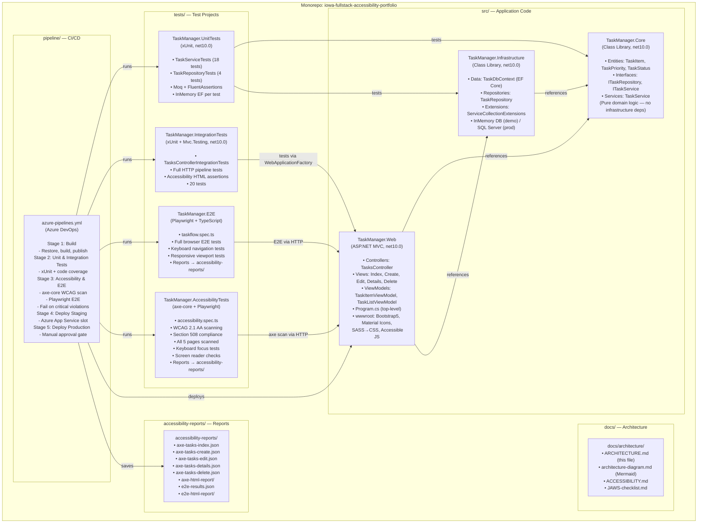

# TaskFlow Architecture Diagram

## Technology Stack

| Layer | Technology | Version |
|-------|-----------|---------|
| Runtime | .NET | 10.0 |
| Web Framework | ASP.NET Core MVC | 9.0.5 |
| ORM | Entity Framework Core | 9.0.5 |
| Database (demo) | EF Core InMemory | 9.0.5 |
| UI Framework | Bootstrap | 5.3 (bundled) |
| UI Icons | Material Icons | Google CDN |
| Fonts | Roboto (Google Fonts) | CDN |
| Styling | CSS (WCAG-compliant) | Custom |
| Unit Testing | xUnit | 2.9.3 |
| Assertions | FluentAssertions | 6.12.2 |
| Mocking | Moq | 4.20.72 |
| Integration Testing | Microsoft.Mvc.Testing | 9.0.5 |
| E2E Testing | Playwright | 1.49.0 |
| Accessibility Scanning | axe-core / @axe-core/playwright | 4.10.0 |
| CI/CD | Azure DevOps Pipelines | YAML v1 |

## Accessibility Standards Implemented

| Standard | Criteria | Implementation |
|----------|----------|----------------|
| WCAG 2.1 AA | 1.1.1 Non-text Content | `aria-hidden` on decorative icons, `alt` on images |
| WCAG 2.1 AA | 1.3.1 Info & Relationships | Semantic HTML, ARIA roles, `<table>` with `scope` |
| WCAG 2.1 AA | 1.4.3 Contrast (min 4.5:1) | All colors verified; custom CSS tokens |
| WCAG 2.1 AA | 1.4.4 Resize Text | Fluid layout, rem units |
| WCAG 2.1 AA | 1.4.10 Reflow | Responsive Bootstrap grid, no horizontal scroll |
| WCAG 2.1 AA | 1.4.11 Non-text Contrast | UI component borders at 3:1 |
| WCAG 2.1 AA | 2.1.1 Keyboard | All interactions keyboard-operable |
| WCAG 2.1 AA | 2.4.1 Bypass Blocks | Skip Navigation link |
| WCAG 2.1 AA | 2.4.2 Page Titled | Unique `<title>` per page |
| WCAG 2.1 AA | 2.4.4 Link Purpose | Descriptive `aria-label` on all links |
| WCAG 2.1 AA | 2.4.7 Focus Visible | 3px outline + box-shadow on `:focus-visible` |
| WCAG 2.1 AA | 3.1.1 Language of Page | `<html lang="en">` |
| WCAG 2.1 AA | 3.3.1 Error Identification | `aria-invalid`, `aria-describedby` on errors |
| WCAG 2.1 AA | 3.3.2 Labels or Instructions | All form inputs have visible `<label>` |
| WCAG 2.1 AA | 4.1.2 Name, Role, Value | ARIA attributes on all interactive elements |
| WCAG 2.1 AA | 4.1.3 Status Messages | `aria-live="polite"` live regions |
| Section 508 | 1194.22 (a) | Alt text on images |
| Section 508 | 1194.22 (l) | No auto-play, reduced motion support |
| Section 508 | 1194.22 (n) | Forms have accessible labels |
| Section 508 | 1194.22 (o) | Skip navigation provided |

## JAWS Screen Reader Checklist

- [x] Page title announced on load
- [x] Landmark regions announced (banner, main, contentinfo, navigation)
- [x] Skip link available and functional
- [x] All headings in logical hierarchy (H1 → H2)
- [x] Form labels correctly associated via `for`/`id`
- [x] Required fields announced as required (`aria-required`)
- [x] Error messages announced via `aria-live`
- [x] Table headers announced with scope
- [x] Buttons have descriptive labels
- [x] Links have descriptive text (no "click here")
- [x] Status badges use `aria-label` for context
- [x] Focus order matches visual order
- [x] Modal/confirmation pages follow focus management

## Keyboard Navigation Map

| Key | Action |
|-----|--------|
| `Tab` | Move to next interactive element |
| `Shift+Tab` | Move to previous interactive element |
| `Enter` / `Space` | Activate button or link |
| `Alt+N` | New Task shortcut |
| `Alt+H` | Go Home (navbar brand) |
| `Escape` | Close dropdowns/modals |
| Arrow keys | Navigate within select dropdowns |
